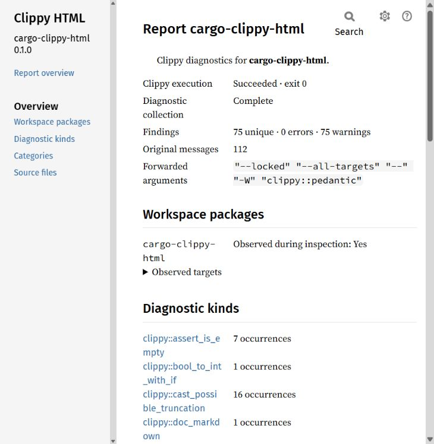

# Clippy HTML

`cargo clippy-html` generates static, rustdoc-style HTML reports from Clippy
diagnostics. Browse findings by lint, category, or source file, and review Clippy's
suggestions as unified diffs.

[](https://imagination12357.github.io/clippy-html/)

## Install from source

Use Rust 1.88 or later to build the tool. Install Clippy for the toolchain you use
to check your project.

```sh
rustup component add clippy
git clone https://github.com/Imagination12357/clippy-html.git
cd clippy-html
cargo install --path . --locked
```

Run the installed command in the Cargo project you want to inspect:

```sh
cargo clippy-html --open
```

The default report is `<Cargo target directory>/clippy-html/index.html`. Open that
file directly in a browser, or serve the generated directory on a static host.

## Usage

```sh
cargo clippy-html --output report
cargo clippy-html --output report --metadata report/metadata.json
cargo clippy-html -- --workspace --all-targets
cargo clippy-html -- --all-targets --all-features -- -W clippy::pedantic
```

| Option | Purpose |
|---|---|
| `--output <DIR>` | Choose the report directory. Relative paths use the invocation directory. |
| `--open` | Open the report after all requested outputs have been published. |
| `--metadata <FILE>` | Write an optional machine-readable navigation index. |
| `--offline` | Use bundled lint categories without fetching the online table. |
| `--help`, `--version` | Show command help or version. |

Arguments after the first `--` go to Cargo Clippy. A second `--` separates Cargo
options from rustc/Clippy options. `--all-targets` and `--all-features` are opt-in.
Forwarded `--target-dir` also changes the default report location. Cargo's
`--fix` and `--message-format` are rejected because the report needs structured
diagnostics from a run that leaves the source untouched.

### Offline generation and reading

When Clippy's diagnostic links identify a single documentation version, the tool
fetches its category table by default. It uses the bundled table if it cannot
identify the version, fetch the table, or validate it. Unmatched Clippy lints
appear under Unknown. Category lookup leaves severity and exit status unchanged.

Put `--offline` before `--` to use bundled categories. Pass it after `--` to
tell Cargo to use locally available dependencies. To do both, run the following.

```sh
cargo clippy-html --offline -- --offline
```

The finished report has its own scripts, styles, and fonts, so you can read it
offline regardless of how you generated it.

## Read the report

Start at the overview to check whether Clippy ran successfully and whether
diagnostic collection finished. It shows packages and counts before and after
merging duplicates across targets. Lint and category pages group related
findings, notes, and suggestions. A lint page can have a URL such as
`lint/clippy/clone_on_copy.html`.

On a source page, use the file tree or a line link to reach a finding. Primary
spans have a stronger background than secondary spans. A purple triangle marks
an insertion point. **Copy patch** copies the entire suggestion, including edits
to multiple files. The report shows the applicability Clippy assigned it.

Search matches all terms across lint names, paths, messages, and categories,
ignoring case. Each tab shows up to 100 matches and the total count. **Summary**
folds diagnostic details while keeping the severity, lint code, message, and
representative location visible. **Show all** expands the details.

Basic pages, links, syntax colors, diffs and individual diagnostic toggles work
without JavaScript. Search, settings, global Summary controls and patch copying
require JavaScript. Clipboard permissions and settings persistence across `file://`
pages depend on the browser.

Press `S` or `/` for search, `?` for Help, `-` to fold diagnostics, and `+` or `=`
to expand them. Escape closes an open Help or Settings popover first. Press it
again to leave search. In Settings, choose light, dark, Ayu, or the system theme.
You can also wrap source lines, hide navigation or the table of contents, and
disable shortcuts.

Findings from different packages or with different severities, spans, or
suggestions remain separate. Full source pages are limited to eligible workspace
files. For dependency files, files in Cargo's target or build directory, and
unreadable or outdated source, the report uses snippets or fallback locations.
If it cannot produce a diff, it shows the original replacement and the reason.

## Navigation metadata

Use `--metadata <FILE>` to write a JSON index that scripts can filter by fields
such as lint code, severity, or category. Omit the flag for HTML output alone.
Resolve URLs against the report root even if the JSON lives elsewhere. Follow a
finding URL for its source links and diagnostic details. [Schema and Python example](docs/metadata.md)

## Failures and existing output

When Clippy fails, the tool can still write a report. It preserves Clippy's
nonzero status and shows incomplete collection separately. Failure to write a
requested output also returns a nonzero status.

The tool builds and checks the report in a temporary directory before replacing
the destination. It will replace only an existing report with the
`.clippy-html-owned` marker and protects project, package, target, and build
roots. A lock prevents concurrent report writes. If an interrupted run leaves a
lock or backup, check the reported path and confirm the generator has stopped
before recovering the old report.

JSON inside the report directory is replaced with the HTML. An external path
passed to `--metadata` can replace a regular file after the HTML is ready. If the
external write fails, the command fails and leaves the new HTML in place.

## Static hosting

Upload the entire report directory, including its styles, fonts, licenses, and
pages. Relative links let you serve it under a path such as `/my-project/`.

Reports can contain workspace source code and local paths. Review those files
before sharing a report or uploading it to Pages.

## License and contributing

Project code and the paperclip icon are available under either the
[MIT license](LICENSE-MIT) or the [Apache License, Version 2.0](LICENSE-APACHE).
Reports include the MIT notices for rustdoc assets and OFL-1.1 licenses for the
fonts under `licenses/`. Inspected source keeps its original license.
[Third-party notices](THIRD-PARTY-NOTICES.md) · [Font sources](assets/vendor/rustdoc/FONTS.md)

For repository tests, packaging checks and CI setup, see
[CONTRIBUTING](https://github.com/Imagination12357/clippy-html/blob/main/CONTRIBUTING.md).
